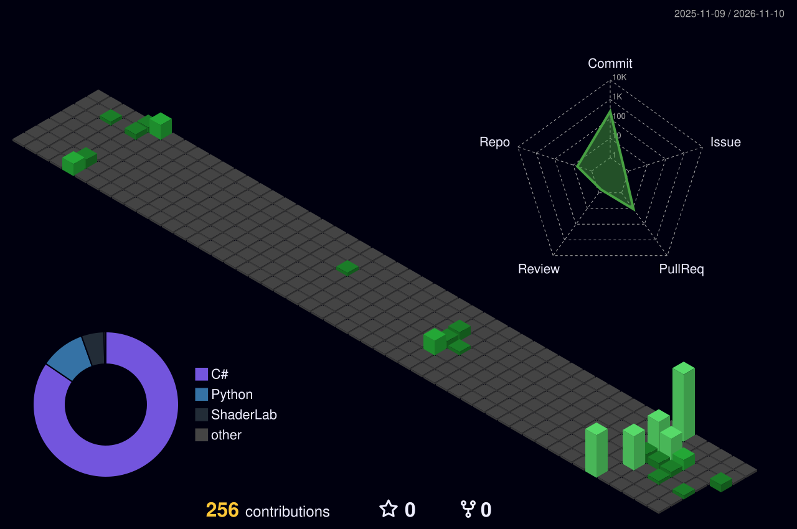

<h1 align="center">Konjac</h1>

  <b>I'm a Konjac.</b> 
  ゲームやツールを作ってます。

  

<h3 align="center">Works</h3>

| Project | 内容 | 技術 | Ver. |
| :-- | :-- | :-: | :-: |
| **[NIGHT//SHIFT](https://github.com/konnnyakuimo2000/night-shift)** | 1998年の深夜のオフィスで、社内ネットワークの接続審査とITサポートを担当する30日間のゲーム |  |  |
| **[meeting_transcriber](https://github.com/konnnyakuimo2000/meeting_transcriber)** | 音声ファイルから文字起こし、話者識別、議事録生成までを行うWebアプリ |  |  |
| **[otp-clip](https://github.com/konnnyakuimo2000/otp-clip)** | メールで届くワンタイムパスワードを、自動でクリップボードにコピーする常駐ツール |  |  |

<h3 align="center">Tech Stack</h3>

  

  
  
  
  

<h3 align="center">Activity</h3>

  

